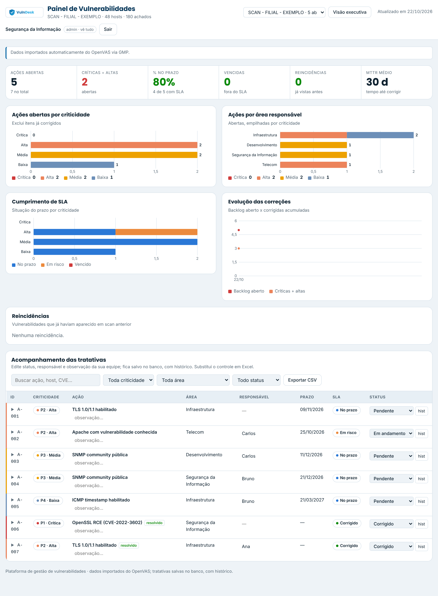
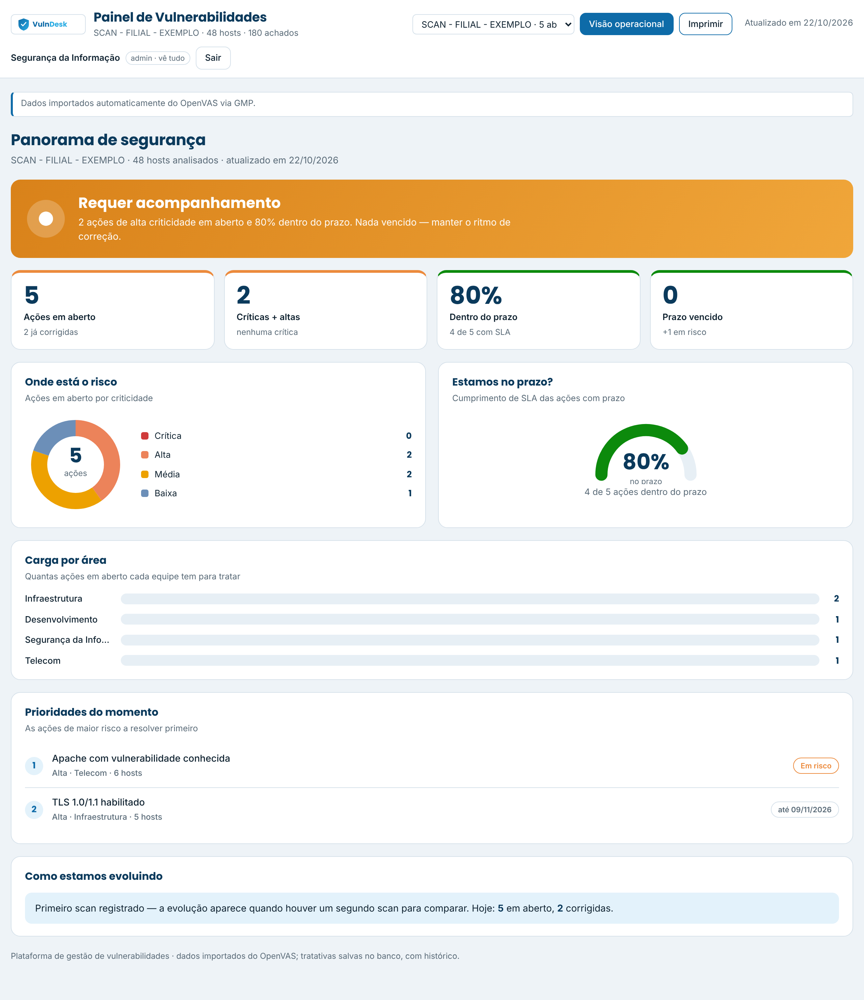
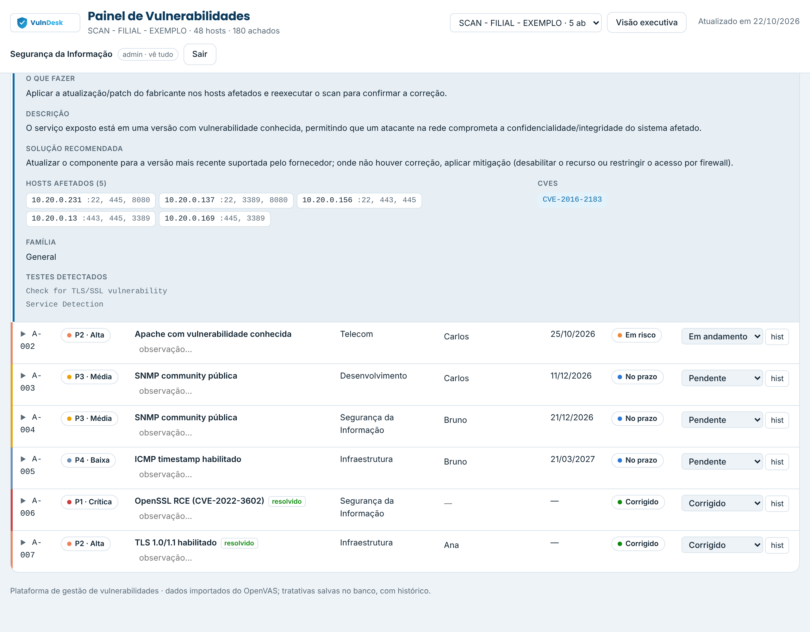
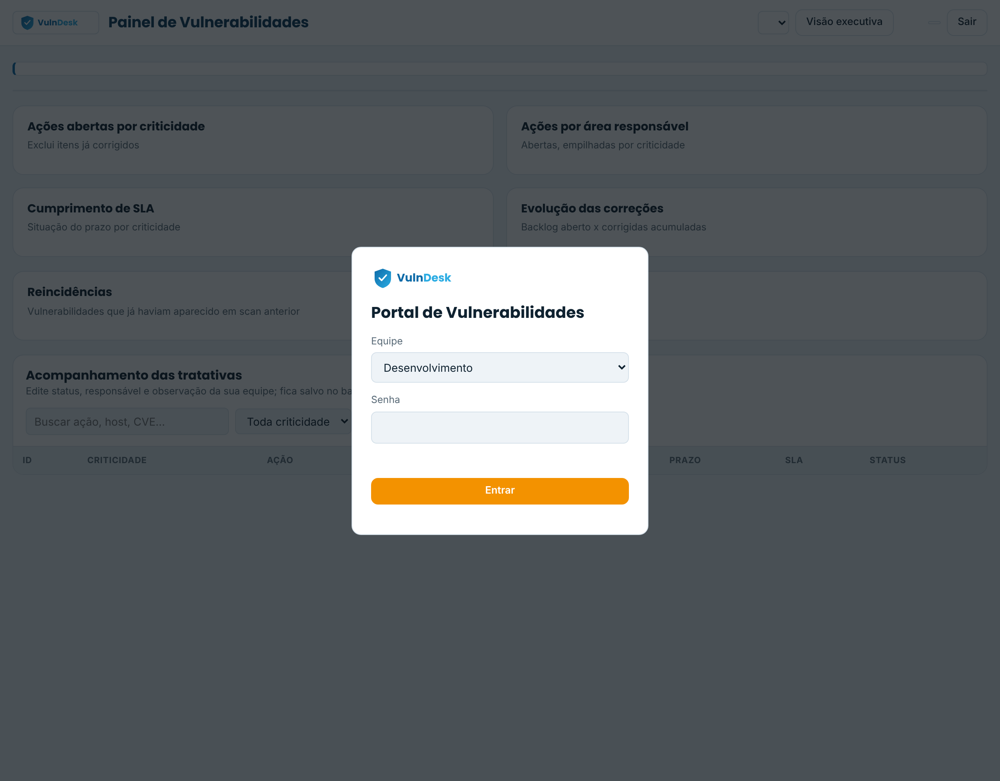

# VulnDesk — Plataforma de Gestão de Vulnerabilidades

Do **scan à correção**, sem planilhas. Uma plataforma que conecta no **OpenVAS/Greenbone** pela API, consolida os achados em **ações priorizadas**, distribui para as equipes responsáveis e acompanha prazos (SLA), reincidência e histórico — com **dashboards**, **login corporativo (AD/LDAP)** e **notificações no Microsoft Teams**.


> ⚠️ **Demo pública e sanitizada.** Este repositório é uma versão de portfólio: não contém dados, credenciais, IPs, domínios ou marcas de nenhum ambiente real. Toda a configuração é fictícia (`example.local`, `10.20.0.0/24`).

---

## ✨ Destaques

- **Automação de ponta a ponta** — conecta no gvmd via **GMP** (`python-gvm`), importa o relatório mais recente e **consolida** centenas de achados em dezenas de ações acionáveis (agrupando por produto/host, deduplicando CVEs).
- **Distribuição automática por equipe** — regras configuráveis (por nome, família, produto, IP) atribuem cada vulnerabilidade à área responsável (Infra, Telecom, Dev, Segurança).
- **SLA, reincidência e MTTR** — prazos por severidade, detecção de itens que voltaram e tempo médio de correção, com **trilha de auditoria por pessoa**.
- **Portal multiusuário** — login por equipe, cada uma edita apenas a sua área; a Segurança vê e edita tudo.
- **Login corporativo (AD/LDAP)** — autenticação pelo usuário de rede, com mapeamento **grupo do AD → área** e **admin por login**.
- **Duas visões** — operacional (tabela editável + gráficos) e **executiva** (semáforo de risco, medidor de SLA, rosca e top prioridades) para a gerência.
- **Detalhe acionável** — cada vulnerabilidade expande com descrição, **o que fazer**, hosts/portas afetados e CVEs.
- **Notificações no Microsoft Teams** — cards por canal (via Workflows/Power Automate): nova crítica/alta, prazo a vencer, vencida e resumo diário por equipe.

## 🖼️ Telas

| Visão operacional | Visão executiva |
|---|---|
|  |  |

| Detalhe da vulnerabilidade | Login |
|---|---|
|  |  |

## 🏗️ Arquitetura

```
OpenVAS/Greenbone ──GMP──▶ importer ──▶ PostgreSQL ◀── API (FastAPI) ──▶ Portal (web)
   (gvmd socket)         (consolida)     (ações,          │  login AD/LDAP
                                          histórico,       │  dashboards + SLA
                                          snapshots)       └──▶ notifier ──▶ Microsoft Teams
```

Três serviços em Docker:

| Serviço | Papel |
|---|---|
| `importer` | Conecta no OpenVAS (GMP), consolida os achados e grava no banco (no intervalo configurado). |
| `api` | API + portal: login, edição das tratativas, dashboards; serve a SPA. |
| `notifier` | Checa SLA e envia os alertas/resumos para o Teams. |

## 🧰 Stack

- **Backend:** Python 3.12, FastAPI, SQLAlchemy 2.0, `python-gvm`, `ldap3`, `passlib` (pbkdf2), `itsdangerous`.
- **Banco:** PostgreSQL 16 (SQLite para testes).
- **Frontend:** HTML/CSS/JS puro, SVG inline (gráficos sem dependências), tema claro/escuro.
- **Infra:** Docker Compose; HTTPS direto no Uvicorn.

## 🚀 Como rodar (ambiente de demonstração)

Requer Docker e Docker Compose.

```bash
git clone https://github.com/P4x1a/vulndesk.git
cd vulndesk

cp .env.example .env            # ajuste as senhas/segredos
cd certs && ./gen-portal-cert.sh && cd ..   # certificado self-signed

docker compose build
docker compose up -d
```

Portal em `https://localhost:8443`. As equipes do `config/config.yaml` são criadas no primeiro boot com a senha de `DEFAULT_TEAM_PASSWORD` (troque com `docker compose exec api python -m api.manage set-password <equipe> <senha>`).

**Testar sem Greenbone (offline):** consolida um XML exportado e grava no banco:

```bash
docker compose exec importer python -m importer.run --from-file /app/data/relatorio.xml
```

## 📁 Estrutura

```
vulndesk/
├── importer/   # conexão GMP + consolidação (parsing, regras de equipe, SLA)
├── api/        # FastAPI: login, ações, histórico, dashboard, sync, auth (local + AD), notify
├── web/        # portal (cliente da API) — SPA de um arquivo
├── config/     # equipes, regras de distribuição, SLA, LDAP, notificações
├── certs/      # geração de certificado para o HTTPS
└── docker-compose.yml · Dockerfile · requirements.txt
```

## ⚙️ Configuração

Tudo em `config/config.yaml`: tarefas a importar, SLA por severidade, equipes, regras de distribuição, mapeamento de grupos do AD e webhooks do Teams. Segredos (credenciais GMP, banco, AD, webhooks) ficam no `.env`.

## 🗺️ Roadmap

- [x] Automação da importação + consolidação (GMP)
- [x] Banco + portal com login e edição persistente
- [x] Dashboards, SLA, reincidência e visão executiva
- [x] Login AD/LDAP e notificações no Teams
- [ ] Exportação de evidências/relatórios para auditoria
- [ ] Agendamento e disparo do scan pela própria plataforma
- [ ] Comparativo entre scans (tendência por ambiente)

## 🔒 Segurança

Pensado para rodar em rede interna: só o `importer` monta o socket do gvmd; o portal é servido por HTTPS; senhas com hash (pbkdf2); tokens de sessão assinados. Trate o `.env` como segredo — ele está no `.gitignore`.

## 👤 Autor

**Gian Vinnicius Moura da Silva** — Segurança da Informação.
Projeto desenvolvido para automatizar a gestão de vulnerabilidades a partir do OpenVAS.

## 📄 Licença

[MIT](LICENSE).
